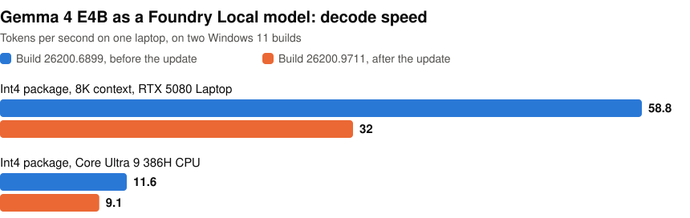

# Gemma 4 E4B as a Foundry Local model on Windows

[google/gemma-4-E4B-it](https://huggingface.co/google/gemma-4-E4B-it) is not in the Foundry Local catalog, and [microsoft/Foundry-Local#1232](https://github.com/microsoft/Foundry-Local/issues/1232) asks for it. This repo builds ONNX Runtime GenAI packages of E4B and runs them as local models in Foundry Local 0.13.0 on one Windows laptop. Two of the packages are ready to download from [Hugging Face](https://huggingface.co/mlboydaisuke/gemma-4-E4B-it-Foundry-Local).

<p align="center">
<picture>
  <source media="(prefers-color-scheme: dark)" srcset="https://raw.githubusercontent.com/john-rocky/gemma-4-e4b-on-foundry-local/main/docs/images/decode-dark.svg">
  
</picture>
</p>

A Windows update on 2026-11-06 slowed decoding on this laptop, but the answers to the 24 test prompts did not change. [What changed](docs/results.md#after-the-windows-update) has the numbers. The test prompts are all text. The packages also hold the vision and audio encoders, which load, but I have not tried an image or audio prompt.

## Which package

| Your machine | Package | Get it | Decode speed, tokens/s | Peak GPU memory |
|---|---|---|---|---|
| RTX GPU with 16 GB | int4, 8K-token context | Download it as below, or build it with [steps 2 to 6](docs/steps.md) | 58.8 before the update, 32 after | 13,294 MiB |
| RTX GPU with less memory | int4, 8K context, fp16 embedding session on the CPU | Build it with [step 7](docs/steps.md) | 47.0 before the update | 9,186 MiB |
| CPU only | the CPU package | [Download it](https://huggingface.co/mlboydaisuke/gemma-4-E4B-it-Foundry-Local), or build it with [step 8](docs/steps.md) | 11.6 before the update, 9.1 after | none |

I ran the CPU package on the same laptop, so I have not tried it on a machine without an NVIDIA GPU. Foundry Local 0.13.0 does not run these packages on the Intel GPU or the NPU. Outside Foundry Local, [step 11](docs/steps.md) runs them on the Intel GPU with ONNX Runtime GenAI 0.19.0.

## Run the prebuilt package

You need an NVIDIA GPU with a driver for CUDA 12, Foundry Local 0.13.0 from `winget install Microsoft.FoundryLocal`, Python 3.12 as `py -3.12`, and the [`hf` command](https://huggingface.co/docs/huggingface_hub/guides/cli). The download is 7.2 GB. Run this in PowerShell from an empty folder:

```powershell
hf download mlboydaisuke/gemma-4-E4B-it-Foundry-Local --include "cuda-int4-8k/*" --local-dir gemma-4-e4b

# Foundry Local's CUDA EP loads the CUDA 12 runtime and cuDNN 9 from PATH; it does not download them
py -3.12 -m venv .venv-dll
& .venv-dll\Scripts\python.exe -m pip install --target cuda12 --no-deps nvidia-cuda-runtime-cu12==12.9.79 nvidia-cuda-nvrtc-cu12==12.9.86 nvidia-cublas-cu12==12.9.2.10 nvidia-cudnn-cu12==9.28.0.42
New-Item -ItemType Directory -Force cuda12-dll | Out-Null
Get-ChildItem cuda12 -Recurse -Filter *.dll | Copy-Item -Destination cuda12-dll
$env:Path = "$PWD\cuda12-dll;$env:Path"
foundry server stop
foundry server start

foundry model register (Resolve-Path gemma-4-e4b\cuda-int4-8k) gemma-4-e4b-it-cuda-int4-8k:1 --task vision-language-chat --device gpu --execution-provider CUDAExecutionProvider
foundry model load gemma-4-e4b-it-cuda-int4-8k:1
foundry complete gemma-4-e4b-it-cuda-int4-8k:1 "What is the capital of Japan? Answer in one word." -m 48 -t 0
```

It answers `Tokyo`. From your own code, call the daemon's REST API at `/catalogs/local/v1`, because `/v1` answers 404 for local models. The [model card](https://huggingface.co/mlboydaisuke/gemma-4-E4B-it-Foundry-Local) covers the CPU package too.

## Build it yourself

[The steps](docs/steps.md) run in PowerShell, in order, from a clone of this repo in an empty folder. They need Python 3.12 as `py -3.12`, Foundry Local 0.13.0, an NVIDIA driver for CUDA 12 and 13, and 99 GB of disk for all eleven steps.

The full numbers are in [Results](docs/results.md), and the errors you may hit are in [What to know](docs/what-to-know.md).

## License

The scripts are under the Apache License 2.0, in [`LICENSE`](LICENSE). So is [Gemma 4](https://huggingface.co/google/gemma-4-E4B-it).
