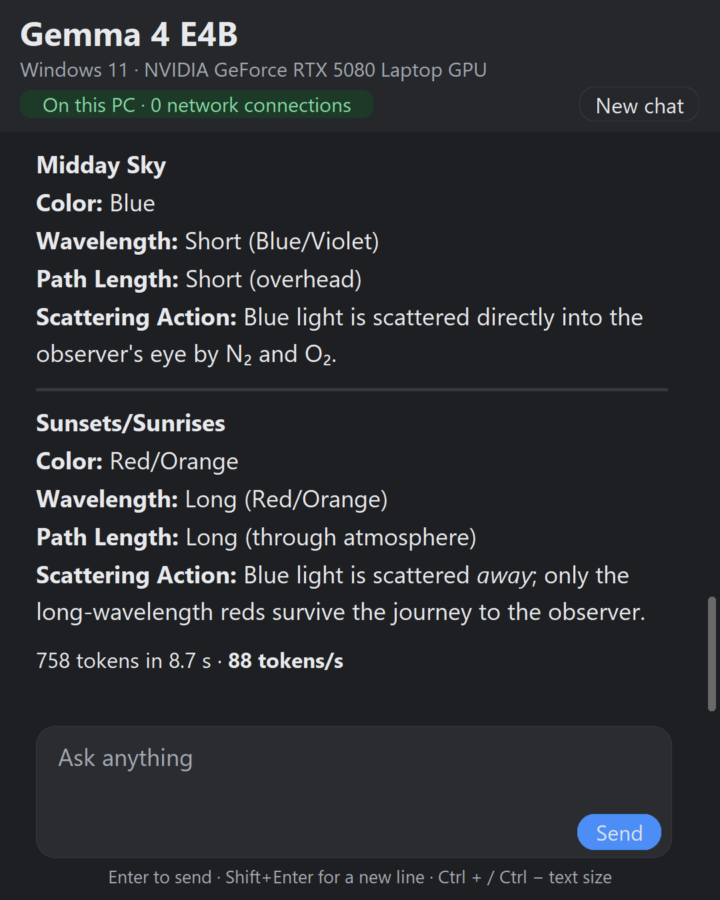

# Chat with Gemma 4 E4B on a Windows PC

A chat window that runs Google's [Gemma 4 E4B](https://huggingface.co/google/gemma-4-E4B-it) on your own Windows 11 PC. On a laptop with an NVIDIA GeForce RTX 5080 Laptop GPU it wrote a 634-token answer in 7.1 s on 2026-11-16. `.\chat.cmd` sets it up and opens it. It needs 64-bit Python 3.12, and I have run it on that one laptop only.

<p align="center">

</p>

The picture shows another answer from the same evening, to the question why the sky is blue. The chat downloads a package of the model made for ONNX Runtime GenAI [from Hugging Face](https://huggingface.co/mlboydaisuke/gemma-4-E4B-it-Foundry-Local) and runs it with ONNX Runtime GenAI 0.19.0, without Foundry Local. The badge in the window counts the network connections the chat holds.

## Run it

```powershell
git clone https://github.com/john-rocky/gemma-4-e4b-on-foundry-local
cd gemma-4-e4b-on-foundry-local\chat
.\chat.cmd
```

You need Windows 11 x64 and 64-bit [Python 3.12](https://www.python.org/downloads/windows/). I used Python 3.12.10 from python.org. When it runs on CUDA, the chat installs the CUDA 13 runtime with pip, so it needs an NVIDIA driver for CUDA 13. The laptop's is 591.74, and I have not checked the oldest one that works.

The first run makes a Python environment next to `chat.cmd` and downloads the model package: 7.2 GB for a GPU, 7.5 GB with `-Device cpu`. The download needs no Hugging Face account. Later runs skip what is done and open the chat at once.

My one first run from an empty folder took 64.3 minutes and 8.8 GB of disk. The Python environment took 40 minutes, with pip downloading at about 0.45 MB/s, and the model took 24 minutes at about 5 MB/s. That is one run on one connection, and the speed of that connection changed more than tenfold within three hours that evening. The next `.\chat.cmd` opened the window in 2.9 s, and the model was ready 7.9 s after the command.

The first screen offers three questions, such as "Explain why the sky is blue." Click one, or type your own in the box under them.

## Which device it uses

`chat.cmd` picks CUDA when the PC has an NVIDIA GPU with 15,000 MiB of memory or more, which means a 16 GB card. On any other PC it picks WebGPU. `-Device cpu` runs the model on the CPU.

I measured all of them on one laptop: an MSI Stealth 16 AI+ with a Core Ultra 9 386H, an RTX 5080 Laptop GPU with 16,303 MiB, 31.5 GiB of RAM and Windows 11 Home 25H2, build 26200. Each row is one answer to "Write a polite email asking my landlord to fix a leaking faucet."

| Runs on | Command that picks it | The text under the answer |
|---|---|---|
| RTX 5080 Laptop GPU, CUDA | `.\chat.cmd` | 634 tokens in 7.1 s · 90 tokens/s |
| RTX 5080 Laptop GPU, WebGPU | `.\chat.cmd -Device webgpu` | 505 tokens in 10.5 s · 51 tokens/s |
| Intel GPU, WebGPU | `.\chat.cmd -Device webgpu -Adapter 1` | 186 tokens in 11.2 s · 18 tokens/s |
| Core Ultra 9 386H | `.\chat.cmd -Device cpu` | 579 tokens in 47.9 s · 12 tokens/s |

In the same session as the first row, six answers on CUDA, three to this question and three to the sky question, ran at 88 to 91 tokens/s. The second and fourth rows come from a session about an hour earlier the same evening, on an earlier version of the window with the same model code.

I have not run it on a PC without an NVIDIA GPU, on an NVIDIA GPU under 15,000 MiB, on an AMD GPU, on Windows 10, on ARM64 Windows or with the Microsoft Store's Python. Display scaling other than 150 % and the light theme are not checked either.

## Options

| Option | What it does |
|---|---|
| `-Device auto\|cuda\|webgpu\|cpu` | Where the model runs. The default is `auto`. |
| `-Adapter <n>` | Which GPU WebGPU runs on. The default is 0. On this laptop 0 is the RTX and 1 is the Intel GPU. |
| `-Context 2048\|4096\|8192` | How many tokens one chat holds, questions and answers together. The default is 4096. |
| `-ModelDir <folder>` | Use a model folder that is already on the PC. The model is not downloaded. |
| `-Log <file>` | Add one JSON row per answer to the file: the question, the answer and the numbers the window showed. |
| `-SetupOnly` | Set up without opening the chat. |

A larger context was slower on CUDA. In one session the email question ran at 99 tokens/s with 2048, at 88 to 89 with 4096 and at 75 with 8192 (one answer each at 2048 and 8192, three at 4096).

## When it does not work

When the setup fails, `chat.cmd` ends with one message, and most of them say what to do next. When the model does not load or its process stops, the window shows a red bar. I caused each of these on the laptop:

- No Python 3.12: `Python 3.12 was not found. Install Python 3.12 (64-bit) from https://www.python.org/downloads/windows/ and run chat.cmd again.`
- Not enough disk: `Not enough free disk space: <free> GB free, about <needed> GB needed. Free some space and run chat.cmd again.`
- A download that is cut: `The download of vision_encoder/model.onnx.data stopped (curl exit -1). Run chat.cmd again: it continues where it stopped.` The same command again continued the kept part of the file and finished the setup.
- Another app holds the GPU's memory. The window shows a red bar with a `Load the model again` button: `Not enough free memory on NVIDIA GeForce RTX 5080 Laptop GPU: 6.0 GB free, about 9.3 GB needed. Close other apps that use the GPU and open the chat again, or start it with chat.cmd -Device cuda to try anyway, or chat.cmd -Device cpu.`
- The model's process stops. The bar reads `The model process stopped (exit code 9).` with the process's last message and the same button. After the reload the window says `The model was loaded again: the next question starts a new chat.` I caused this one with a test process that ends on purpose, not with the real model, and the test code pressed the button, not a mouse.

## The numbers under an answer

`634 tokens in 7.1 s · 90 tokens/s` starts with the answer's token count. The seconds run from the moment the model's process gets the question to the last token. Tokens/s leaves out the wait for the first token: it is the token count minus one, divided by the time from the first token to the last. Both times come from the clock of the process that runs the model.

## The network badge

ONNX Runtime GenAI 0.19.0 and ONNX Runtime 1.31.1 ship with telemetry on by default in their official packages. Their privacy pages say that `ORT_DISABLE_TELEMETRY=1`, set before they initialize, turns it off for the process: [ONNX Runtime GenAI](https://github.com/microsoft/onnxruntime-genai/blob/v0.19.0/docs/Privacy.md), [ONNX Runtime](https://github.com/microsoft/onnxruntime/blob/v1.31.1/docs/Privacy.md). The chat sets that variable before ONNX Runtime loads.

I checked the chat on the laptop in one run. A second program watched the chat's processes while it gave five answers on CUDA. In 312 checks over 86 s it found no endpoint, meaning no TCP connection, no listening TCP port and no bound UDP port.

Earlier the same day I measured both cases on the laptop with a test script, not the chat, that loads the same package with the same two runtime versions. With the variable set, its process held no TCP or UDP endpoint from loading through three answers, in 143 checks at about 4 a second. Without it, a second run of the same script opened one TCP connection to port 443 about 10 seconds after it started and kept it until it ended.

Every second the badge counts the TCP and UDP endpoints that Windows lists for the chat's processes. It shows the number when the count is 1 or more, and "unknown" when it cannot get the count. A connection that opened and closed between two counts would not show.

## Limits

- Text only. The package also holds the vision and audio encoders, and the chat does not use them.
- One chat holds 4,096 tokens by default. A question that does not fit is refused with a one-line message.
- Answers are sampled with the model's `generation_config.json` settings: temperature 1.0, top-k 64, top-p 0.95, one random seed per chat.
- Both packages are quantized to 4-bit integers (int4). On 24 short test prompts, always taking the most likely token and stopping after 48 tokens, they answer right on the same 20 prompts as Google's weights in Hugging Face Transformers. I measured that with test scripts, not through the chat window.
- WebGPU reads the model through a folder of hard links next to it, so there is no second copy on disk. When Windows cannot make the links (a `-ModelDir` folder on another drive, or a drive without hard links) it stops with a one-line message. I checked this with simulated errors, not on a second drive.

## License

The code in this repo is under the [Apache License 2.0](../LICENSE). Google's [model card](https://huggingface.co/google/gemma-4-E4B-it) lists the model's license as apache-2.0 and links [Google's Gemma 4 license page](https://ai.google.dev/gemma/docs/gemma_4_license).
